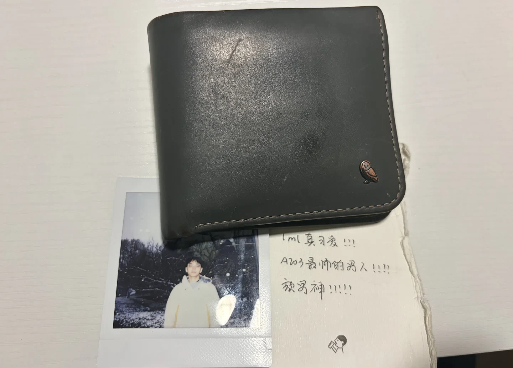

# 找钱包的一天

下午吃完麦当劳猛的发现钱包不见了，心梗了半分钟，毅然决然迈着练完还没回复的腿去找。打了公交车公司两个电话，报了三次警，跑了三个地方。花了三个多小时终于把我的钱包找回来了。在拿回钱包前的一分钟，我的小腿差点报废，真的要抽了。

为什么没有放弃寻找，因为有不得不找回的理由。

{ .note-photo width="1440" height="1036" loading="lazy" decoding="async" }
