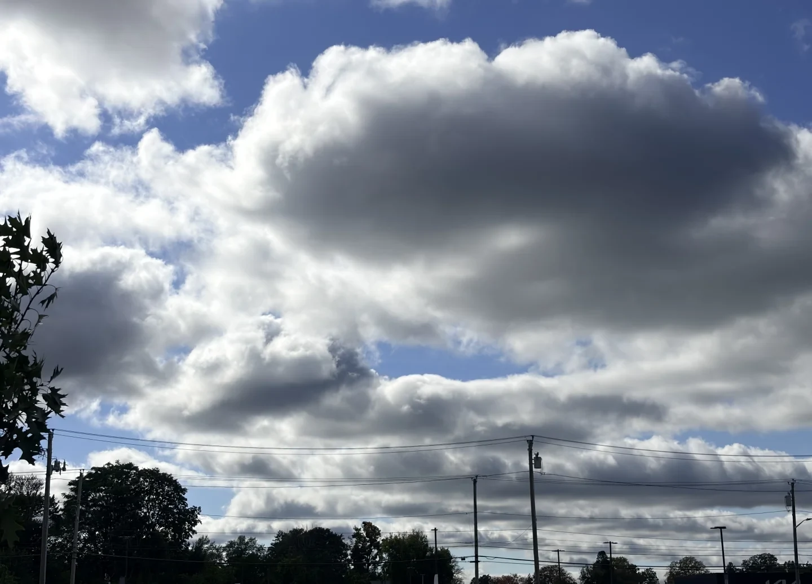

# Have a good day.

来了美国以后，我越发能自如的在和别人说完话以后说一句 have a good day。与其说是表达感谢或客气的道别，不如说是这是对自己的一次心理暗示加强。为什么是 have a good day 而不是 have a good week, month, year, life 呢？我觉得人生总是会起起伏伏，太过关注未来的事情也不是什么好事，也难以抵抗环境和时代的波涛汹涌。不如每天告诉自己过好这一天，能把当天过好就是很了不起的事情了，所以对别人的祝福到这里也足够了。秋假结束，收心，好好吃饭好好健身好好睡觉吧。

{ .note-photo width="1440" height="1036" loading="lazy" decoding="async" }
