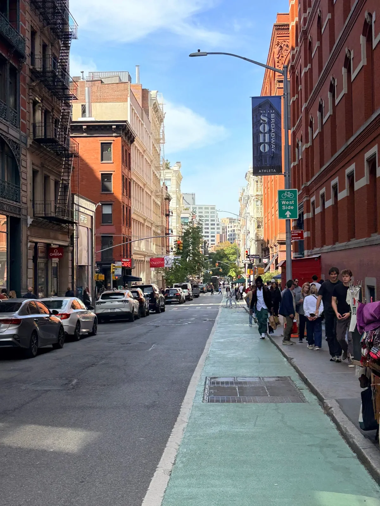
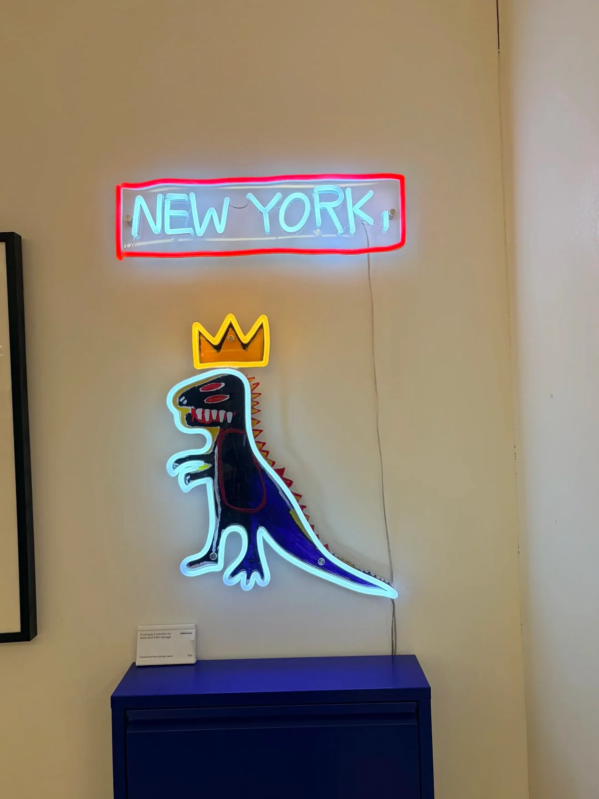
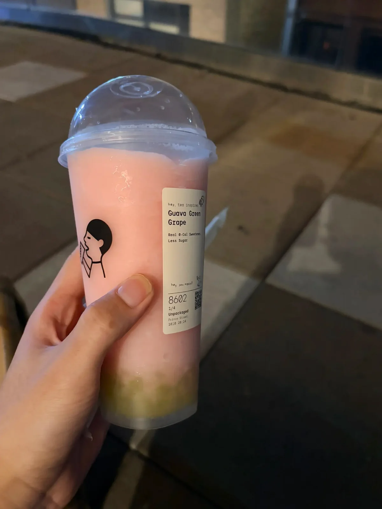
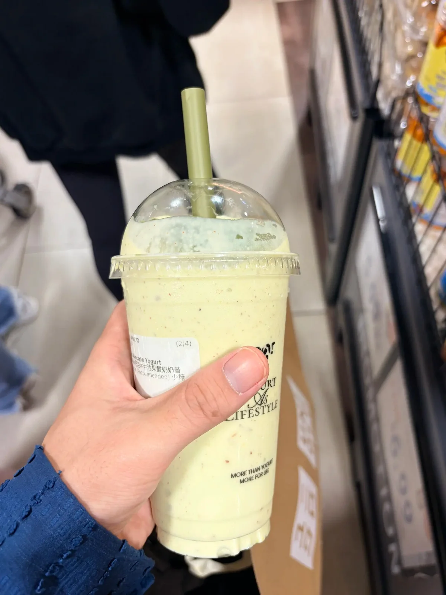

# NYC.

放秋假浅玩两天 法拉盛吃的好多

{ width="1200" height="1600" loading="lazy" decoding="async" }
{ width="1600" height="1200" loading="lazy" decoding="async" }
{ width="1200" height="1600" loading="lazy" decoding="async" }
{ width="1200" height="1600" loading="lazy" decoding="async" }
{ width="1200" height="1600" loading="lazy" decoding="async" }
{ width="1600" height="1200" loading="lazy" decoding="async" }
{ width="1200" height="1600" loading="lazy" decoding="async" }
{ width="1200" height="1600" loading="lazy" decoding="async" }
{ width="1600" height="1200" loading="lazy" decoding="async" }
{ width="1200" height="1600" loading="lazy" decoding="async" }
{ width="1600" height="1200" loading="lazy" decoding="async" }
{ width="1200" height="1600" loading="lazy" decoding="async" }
{ width="1200" height="1600" loading="lazy" decoding="async" }
{ width="1600" height="1200" loading="lazy" decoding="async" }
{ width="1200" height="1600" loading="lazy" decoding="async" }
{ width="1200" height="1600" loading="lazy" decoding="async" }
{ width="1600" height="1200" loading="lazy" decoding="async" }

