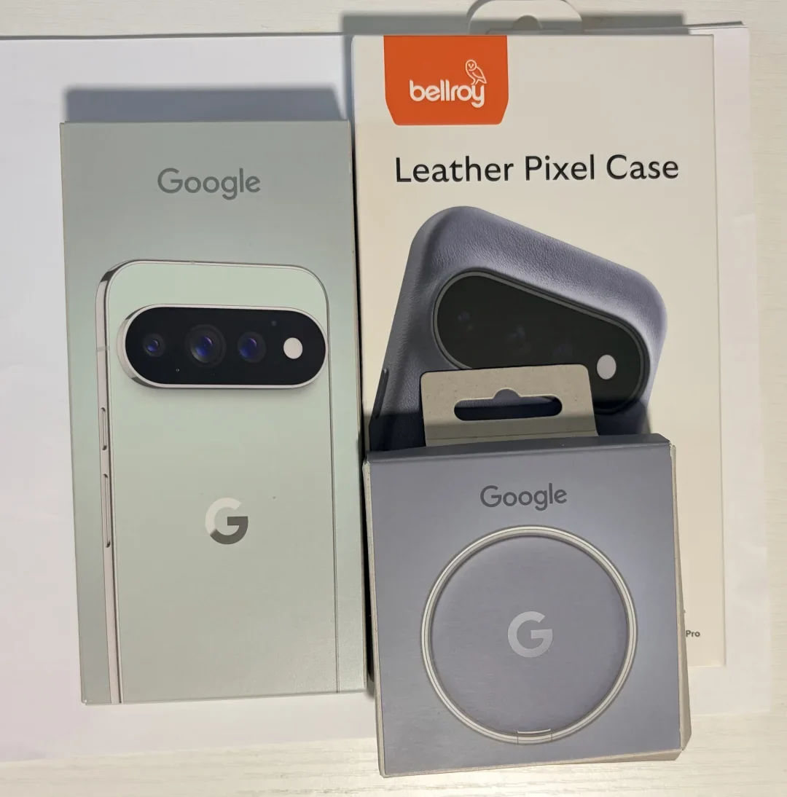
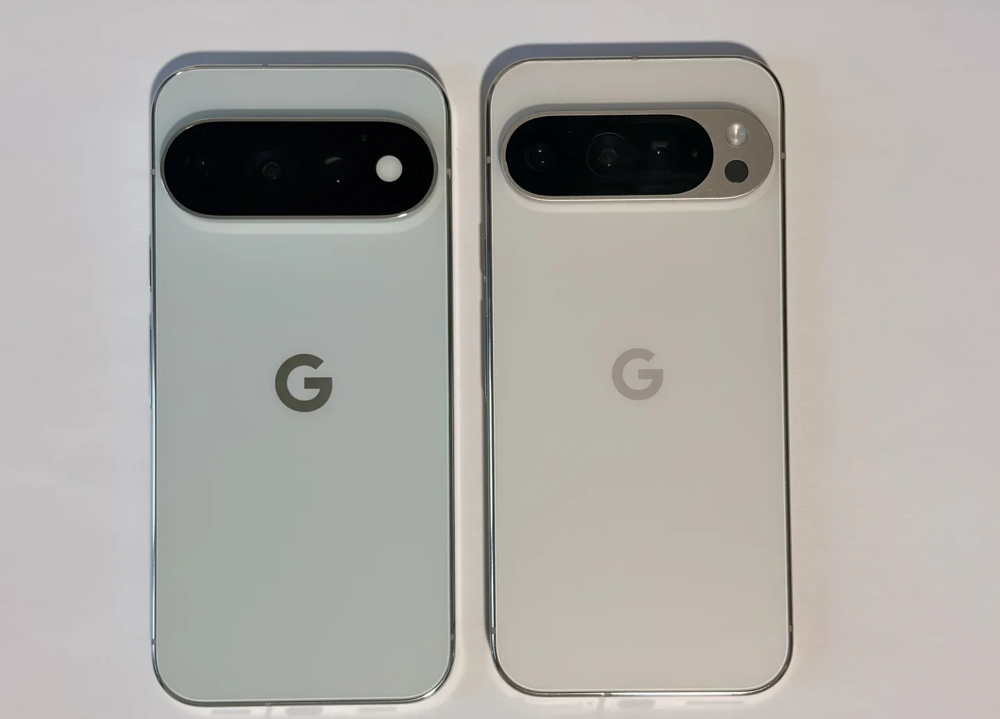
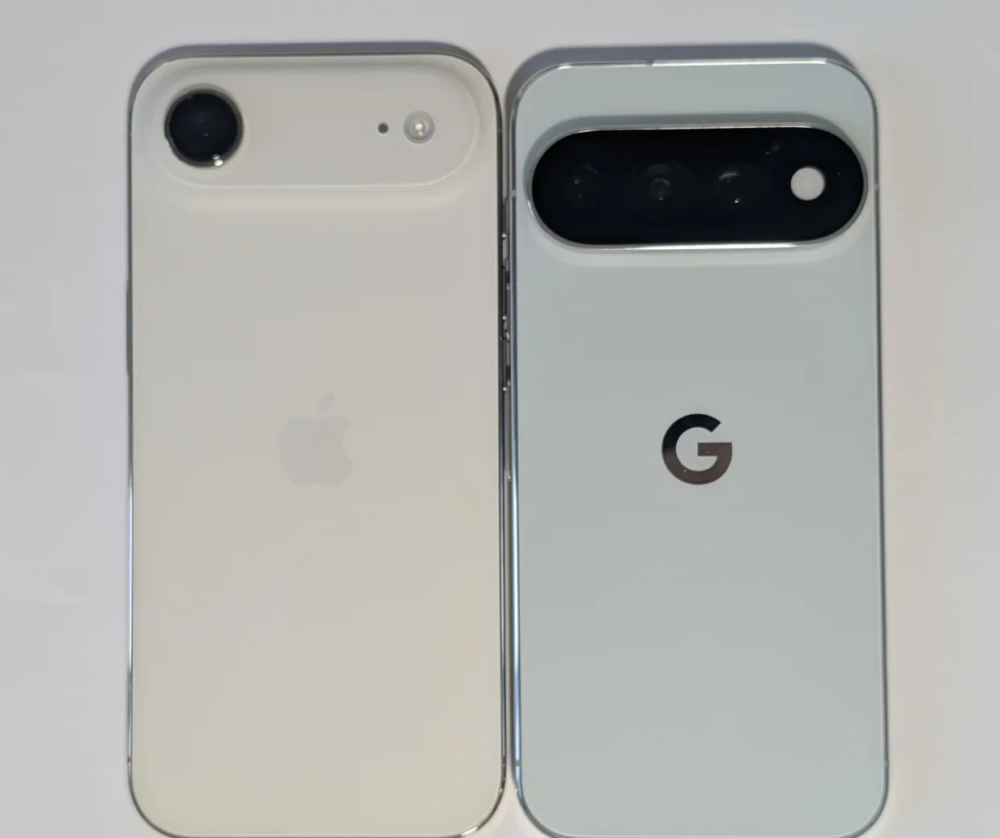
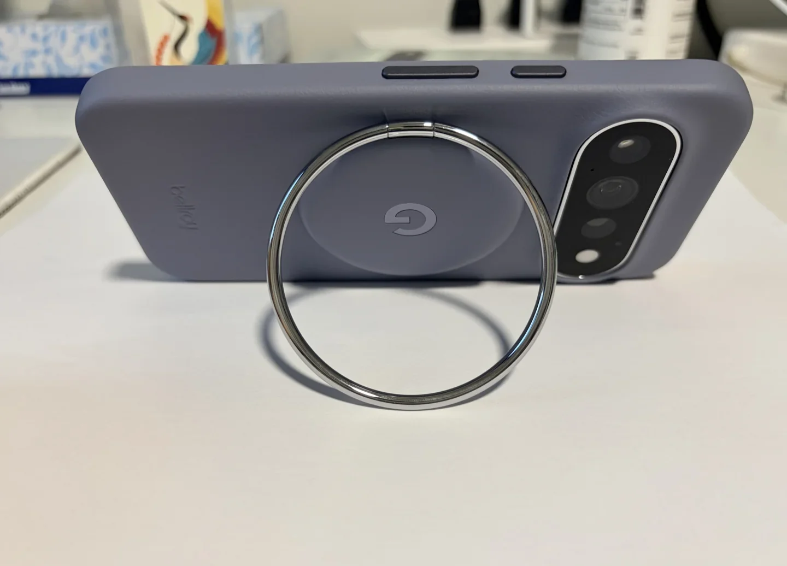
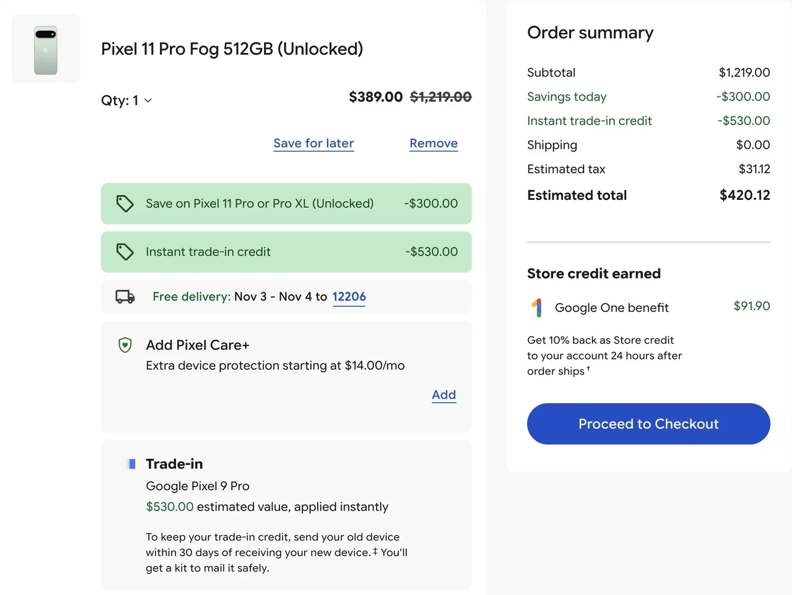
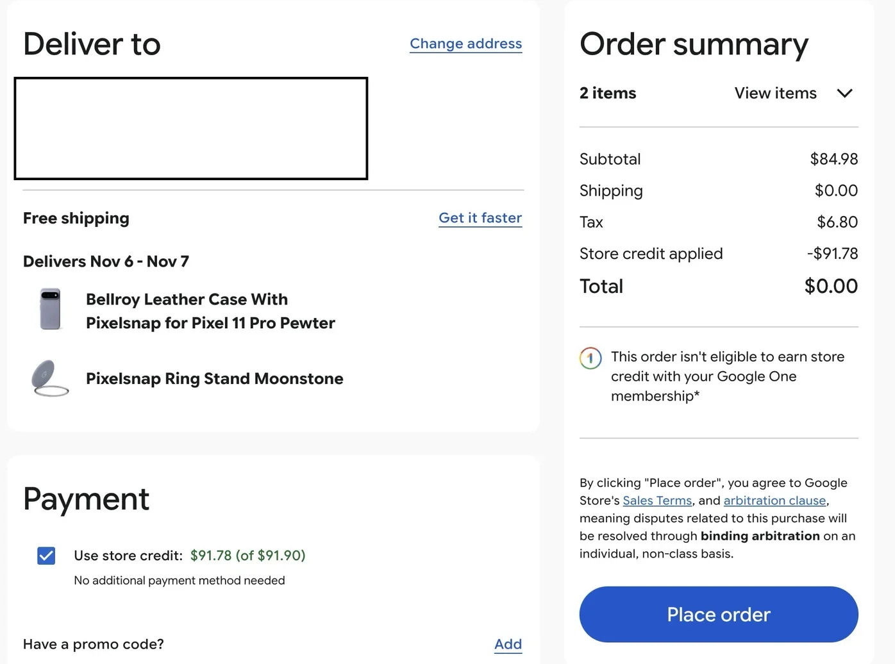

# 咕咕咕，新像素手机。

谷歌一个大优惠就给我唬的不要不要。

400 刀 从 Pixel 9 Pro 128G 升级到11 Pro 512G，好像还能接受。

用返点刚刚好买个手机壳和支架。

今年没有纯白色了，只能退而求其次买这个青色。

Good！

{ width="1080" height="1094" loading="lazy" decoding="async" }
{ width="1440" height="1036" loading="lazy" decoding="async" }
{ width="1235" height="1036" loading="lazy" decoding="async" }
{ width="1440" height="1036" loading="lazy" decoding="async" }
{ width="1377" height="1036" loading="lazy" decoding="async" }
{ width="1396" height="1036" loading="lazy" decoding="async" }

